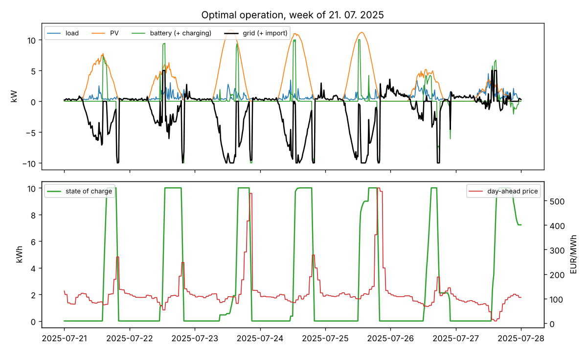
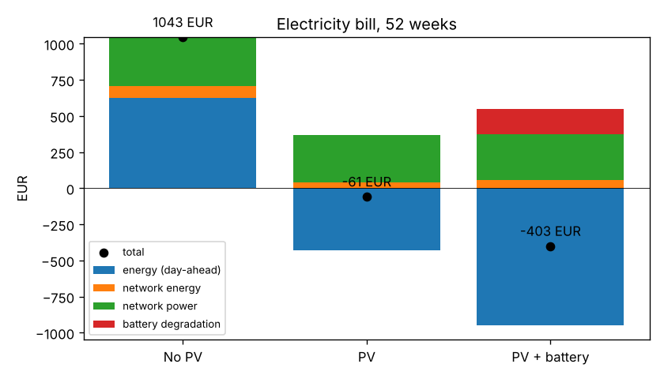
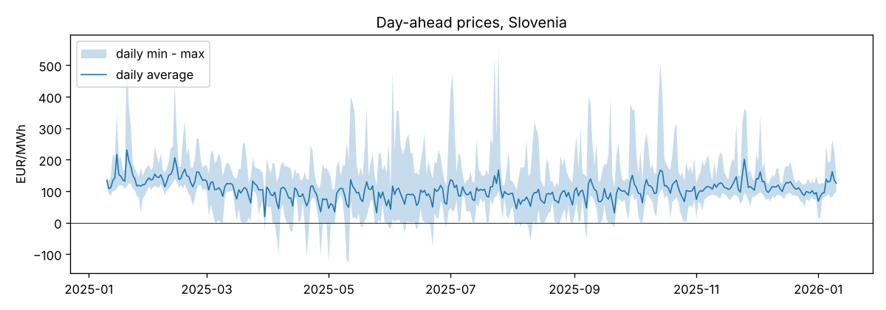

# Battery optimisation

Mixed-integer linear programming (MILP) model for the optimal operation of a household battery with PV, built with
[Pyomo](https://www.pyomo.org/). The battery is scheduled in 15-minute steps, one week at a time, so that the
electricity bill under Slovenian day-ahead prices and the Slovenian network tariff is as low as possible.



## Results

One year of measured household consumption (Jan 2025 – Jan 2026), a 15 kWp PV plant and a 10 kWh / 10 kW battery:

| | No PV | PV | PV + battery |
| --- | ---: | ---: | ---: |
| Energy at day-ahead prices | 626 € | −428 € | −949 € |
| Network tariff – energy | 83 € | 43 € | 54 € |
| Network tariff – power | 334 € | 325 € | 319 € |
| Battery degradation | – | – | 173 € |
| **Total** | **1043 €** | **−61 €** | **−403 €** |

The optimisation runs week by week, the bill is then calculated for every month (the power charge uses the monthly
peak, at least the 5 kW settlement power) and summed over the year. A negative total means that the revenue from
exported energy is larger than the costs.

The battery saves **342 € per year** compared to PV alone (515 € minus 173 € degradation), with about 350 full
cycles. Most of the saving comes from storing PV energy and selling it in the evening price peaks, so it is largest
from spring to autumn (50–65 € per month) and small in winter (5–20 € per month). The network power charge hardly
changes, because the minimum settlement power is already above most of the household's peaks.





## Model

The objective minimises the sum of:

- **energy cost** – grid import at day-ahead prices minus revenue for exported energy,
- **network energy charge** – imported energy in each of the 5 tariff time blocks times the block price,
- **network power charge** – the peak import power of the window (at least the settlement power) times the power price
  (in the model per weekly window, in the bill per month),
- **battery degradation** – battery throughput divided by capacity and lifetime cycles, times the battery price.

Constraints: power balance at the meter (PV can be curtailed), state of charge with charging and discharging
efficiency, a binary variable that prevents simultaneous charging and discharging, battery and grid power limits,
and the state of charge at the end of every week (90 % of capacity).

## Project structure

```
battery_optimisation/
├── model.py          MILP model (Pyomo)
├── tariffs.py        Slovenian network tariff time blocks
└── simulation.py     input data, weekly optimisation loop, monthly electricity bill
scripts/
├── generate_pv.py    synthetic PV profile with pvlib
└── download_prices.py  day-ahead prices from the Energy-Charts API
notebooks/
└── battery_optimisation.ipynb   parameters, optimisation, results and figures
data/
├── load_household1.csv    household with an existing PV plant (net power), use with PV size 0
├── load_household2.csv    household without PV
├── pv_data.csv            synthetic PV profile for 1 kWp
└── day_ahead_prices.csv   SI day-ahead prices (EUR/MWh)
docs/                      figures used in this README
```

All timestamps are local time (Europe/Ljubljana) and mark the end of the 15-minute interval.

## Data

- **Consumption** – smart meter data of two households (active power, 15 min).
- **PV** – `python scripts/generate_pv.py` creates a profile for 1 kWp in Ljubljana with
  [pvlib](https://pvlib-python.readthedocs.io): Ineichen clear sky, random daily cloudiness, Erbs decomposition,
  transposition to a 30° south-facing panel and the PVWatts model with cell temperature (~1050 kWh/kWp per year).
- **Prices** – `python scripts/download_prices.py` downloads Slovenian day-ahead prices from
  [Energy-Charts](https://energy-charts.info) (CC BY 4.0, Bundesnetzagentur | SMARD.de).

## Running

```bash
pip install -r requirements.txt
# MILP solver: CBC (conda install -c conda-forge coincbc) or HiGHS (pip install highspy, SOLVER = 'appsi_highs')
python scripts/generate_pv.py
python scripts/download_prices.py
jupyter notebook notebooks/battery_optimisation.ipynb
```

With HiGHS one week (672 time steps) solves in under a second, the whole year in about half a minute.

## License

[Apache 2.0](LICENSE)
